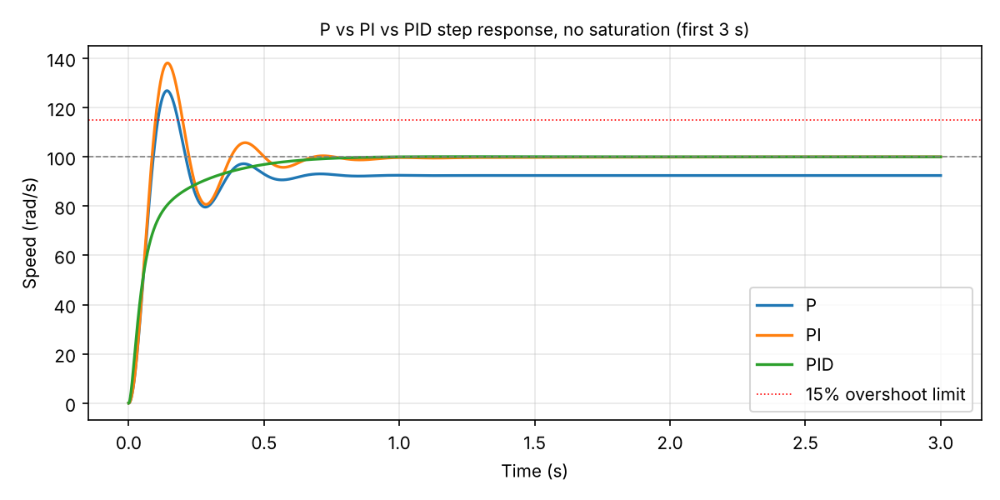
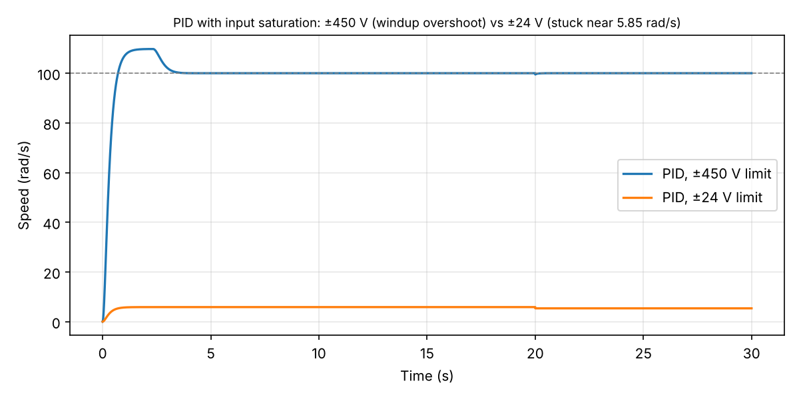

# DC Motor Speed Control with PID (MATLAB/Simulink)

Term project for Automatic Control at King Khalid University (2026). The aim was to hold a DC motor at 100 rad/s with under 2 s rise time and under 15% overshoot, while rejecting a load disturbance.

## What I did

- Modeled the motor from first principles (KVL and Newton's second law) and derived the transfer function
  G(s) = 0.1 / (0.01s² + 0.14s + 0.41)
- Designed and compared P, PI and PID controllers
- Built the closed loop in Simulink with input saturation and a load disturbance at t = 20 s

## Main finding

The controller was not the limiting factor. With the specified ±24 V supply, the motor can only reach about 5.85 rad/s. Reaching 100 rad/s needs about 410 V at steady state, because of the motor's high friction (b = 0.2). A real 24 V design would need a motor with a higher torque constant or a gearbox.

A second finding: once the controller output hits the voltage limit, PI and PID behave almost the same and the integrator winds up. This is why practical controllers use anti-windup.

## Results (saturation removed)

| Controller | Kp | Ki | Kd | Rise time (s) | Overshoot (%) | Steady-state error |
| --- | --- | --- | --- | --- | --- | --- |
| P | 50 | 0 | 0 | 0.06 | 37 | 7.6% |
| PI | 50 | 100 | 0 | 0.06 | 38 | 0% |
| PID | 15 | 40 | 1.5 | 0.26 | 0.1 | 0% |

Rise time is 10-90%. Only the PID meets both targets.

## Files

| File | What it is |
| --- | --- |
| `dc_motor_pid_speed_control.slx` | Simulink model (PID, saturation, load disturbance) |
| `dc_motor_pid.m` | MATLAB script version: builds the model, compares P/PI/PID, simulates saturation |
| `DC_Motor_PID_Report.pdf` | Full project report |
| `plots/` | Step responses for P, PI and PID, the saturation cases, and the Simulink diagram |

Motor parameters: R = 2 Ω, L = 0.5 H, J = 0.02 kg·m², b = 0.2 N·m·s/rad, K = 0.1 V·s/rad.

The plots in `plots/` were regenerated from the same model and gains with a short Python script, after the original report's comparison table was corrected.
